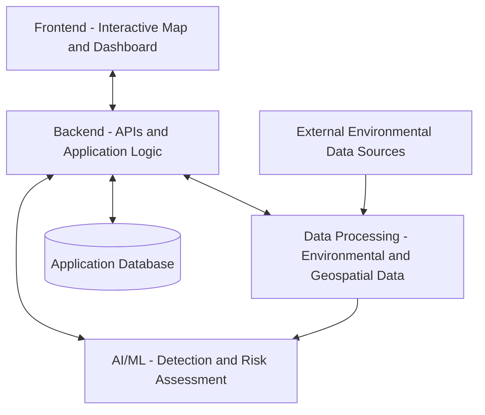

# Wildfire Early Detection and Risk Assessment Platform

**Team Ash Detectives | ECE444 – Software Engineering | University of Toronto**

> **Status:** Under development — first implementation sprint. The capabilities described below are planned and will be delivered incrementally.

## Overview

The Wildfire Early Detection and Risk Assessment Platform is a software engineering project designed to help users identify potential wildfire events and understand wildfire risk in selected geographic areas.

The proposed system combines environmental and geospatial data with AI/ML-based analysis, presenting detection results, risk levels, and contributing conditions through an interactive map. The platform also aims to communicate uncertainty and handle missing data or service failures clearly.

## Planned Key Features

| Feature | Description |
| --- | --- |
| Wildfire detection | Analyze relevant data to identify potential wildfire events. |
| Detection results | Display detected locations, timestamps, and model confidence where available. |
| Wildfire risk assessment | Assess geographic wildfire risk using relevant environmental factors. |
| Interactive risk map | Visualize geographic risk levels through a map or heatmap. |
| Risk details | Allow users to inspect risk levels and contributing environmental conditions for a selected area. |
| Data availability indicators | Distinguish missing, unavailable, or incomplete information from valid observations. |
| Failure handling | Handle errors involving external data sources, APIs, and model processing gracefully. |
| Modular architecture | Separate frontend, backend, data processing, and AI/ML responsibilities. |
| Automated testing | Introduce tests and continuous integration checks as implementation progresses. |

**Important:** Wildfire risk and detection confidence are different measures. Risk describes the assessed potential for wildfire in an area; detection confidence describes how strongly a model supports a particular detection.

## System Architecture

The proposed application has four main components:

1. **Frontend:** Presents an interactive map, wildfire detections, risk details, environmental conditions, and system-status messages.
2. **Backend:** Exposes application APIs, applies application logic, and coordinates communication among components.
3. **Data Processing:** Collects, validates, and transforms environmental and geospatial inputs.
4. **AI/ML:** Analyzes prepared inputs to support wildfire detection and risk assessment.

The following diagram is conceptual; final integration and deployment details will be determined during implementation.



## Requirements

Functional and non-functional requirements are documented in [`docs/requirements.md`](docs/requirements.md). This document records selected user stories, priorities, rationale, acceptance criteria, and references to their GitHub Issues.

## Project Management Tools and URLs

The team uses GitHub-based tools for source control, issue tracking, sprint planning, and code review.

| Tool | Purpose | URL |
| --- | --- | --- |
| GitHub Repository | Source code, documentation, and version control | [Repository](https://github.com/RianaMalhotra/ECE444-PROJECT) |
| GitHub Issues | User stories, requirements, bugs, and development tasks | [Issues](https://github.com/RianaMalhotra/ECE444-PROJECT/issues) |
| GitHub Projects | Kanban board for sprint planning and progress tracking | [Project Board](https://github.com/users/RianaMalhotra/projects/1) |
| GitHub Pull Requests | Code review and integration | [Pull Requests](https://github.com/RianaMalhotra/ECE444-PROJECT/pulls) |
| Repository Documentation | Requirements and project documentation | [Requirements](https://github.com/RianaMalhotra/ECE444-PROJECT/blob/main/docs/requirements.md) 

Team collaboration standards are described in [`CONTRIBUTING.md`](CONTRIBUTING.md), [`CODE_OF_CONDUCT.md`](CODE_OF_CONDUCT.md), and [`team_workflow.md`](team_workflow.md).

## Agile Development and Sprint Tracking

Development follows an issue-driven, iterative workflow:

1. **Backlog prioritization:** Review user stories based on importance, dependencies, and implementation readiness.
2. **Sprint planning:** Select high-priority stories and break them into actionable tasks.
3. **Task estimation:** Assign owners and estimate the hours needed for each task.
4. **Implementation:** Work on dedicated Git branches and reference related issues.
5. **Progress tracking:** Update task status on the GitHub Projects board (`Todo → In Progress → Done`).
6. **Code review:** Submit Pull Requests for review before merging approved changes.
7. **Sprint review:** Record actual hours, evaluate progress against estimates, and identify improvements.

### Sprint Documentation

Sprint reports are maintained in the repository's `docs/` directory as they become available. Each report is intended to include the prioritized backlog, completed work, next-sprint plan, task estimates versus actual hours, and supporting project-management evidence.

## Repository Structure

The repository currently focuses on requirements and collaboration documentation. The intended application structure is shown below; **not all listed application directories have been created yet**.

```text
ECE444-PROJECT/
├── docs/
│   ├── requirements.md
│   └── sprint-report.pdf
├── frontend/             # Planned UI and interactive map
├── backend/              # Planned APIs and application logic
├── ml/                   # Planned detection and risk models
├── data-processing/      # Planned ingestion and validation
├── tests/                # Planned automated tests
├── README.md
├── CONTRIBUTING.md
├── CODE_OF_CONDUCT.md
├── team_members.md
└── team_workflow.md
```

This structure is illustrative and will be updated to reflect actual files and directories as development proceeds.

## Testing and Quality Assurance

Automated tests and CI checks are planned as the application develops. Testing priorities include:

- Core functionality and expected user workflows
- Backend API responses and error handling
- Environmental and geospatial data validation
- AI/ML and risk-processing behavior
- Integration between application components
- Regression prevention after changes

Testing instructions and CI status will be documented once the corresponding tooling is implemented.

## Getting Started

The application is not yet available as a complete runnable system. Installation requirements, configuration instructions, and local development commands will be added when the initial implementation is ready.

## Contributing

Team members should link work to relevant GitHub Issues, use dedicated branches, and submit changes through Pull Requests for review. See [`CONTRIBUTING.md`](CONTRIBUTING.md) for the development workflow and [`CODE_OF_CONDUCT.md`](CODE_OF_CONDUCT.md) for community and collaboration standards.

## Team

Developed by **Team Ash Detectives** for **ECE444 – Software Engineering** at the **University of Toronto**.

See [`team_members.md`](team_members.md) for team information and [`team_workflow.md`](team_workflow.md) for collaboration practices.

## Current Project Status

🚧 **Under Development — First Implementation Sprint**

The team is moving from requirements engineering and backlog prioritization into implementation. Current priorities include establishing the application structure, implementing high-priority user stories, defining interfaces between components, and introducing foundational tests. Progress is tracked through GitHub Issues and the GitHub Projects board.
